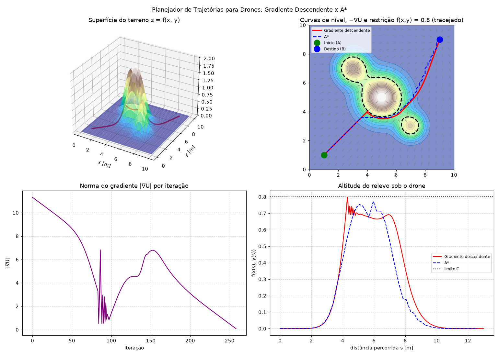

# 🚁 Planejador de Trajetórias para Drones via Gradiente Descendente

## 🏫 Informações Institucionais
* **Instituição:** Fundação Universidade Federal de Rondônia (UNIR), DACC
* **Curso:** Bacharelado em Ciência da Computação
* **Disciplina:** Cálculo III (com foco extensionista)
* **Professor:** Rodrigo Duarte de Oliveira Tolêdo
* **Período:** 2º Semestre / 2026
* **Projeto de Extensão:** "Matemática em Código"

### 👥 Integrantes do Grupo
* Deivison Corrêa Lima
* Jean Henrique Cruz Felini
* Marcelo Reis da Cruz
* Sandy Pereira Campos
* Victor Matheus Menezes Teixeira

## 🔍 Visão Geral do Projeto
Um drone precisa ir de um ponto **A** até um ponto **B** sobre um terreno com morros, sem sobrevoar regiões
acima de uma altitude de segurança **C**. O software modela o relevo como uma função de duas variáveis
z = f(x, y), constrói um **campo potencial** que atrai o drone ao destino e o repele do relevo, e encontra a
rota por **Gradiente Descendente**. O resultado é comparado com o algoritmo A* do protótipo da AV1.

Toda a matemática (derivadas parciais, gradiente, comprimento de arco, integrais de linha e dupla) é
implementada pela equipe em [`src/calculo.py`](src/calculo.py), [`src/terreno.py`](src/terreno.py) e
[`src/planejador.py`](src/planejador.py). NumPy é usado só para aritmética de vetores e Matplotlib só para desenhar.

## 📐 Conceitos de Cálculo Aplicados

| Conceito | Disciplina | Onde está no código |
|---|---|---|
| Função de várias variáveis z = f(x, y) | Cálculo II | `Terreno.altura` |
| Curvas de nível f(x, y) = c | Cálculo II | gráfico 2 (`contour`) |
| Derivadas parciais analíticas (regra da cadeia) | Cálculo III | `Terreno.gradiente` |
| Derivadas parciais numéricas (diferenças centrais) | Cálculo III | `calculo.derivada_parcial` |
| Plano tangente e inclinação \|∇f\| | Cálculo III | `Terreno.plano_tangente` |
| Derivada direcional D_u f = ∇f · u | Cálculo III | `calculo.derivada_direcional` |
| Gradiente descendente | Cálculo III | `PlanejadorGradiente.planejar` |
| Otimização condicionada (penalidade) | Cálculo III | `PlanejadorGradiente.gradiente_potencial` |
| Comprimento de arco | Cálculo I | `calculo.comprimento_de_arco` |
| Integral de linha ∫F·dr (vento) | Cálculo III | `calculo.integral_de_linha` |
| Integral dupla ∬f dA (volume) | Cálculo III | `calculo.integral_dupla` |

### 1. Modelagem do Terreno
O relevo é uma soma de morros gaussianos:

```text
f(x, y) = Σ Aᵢ · exp( −[(x − cxᵢ)² + (y − cyᵢ)²] / (2·sᵢ²) )
```

Pela regra da cadeia:

```text
∂f/∂x = Σ −(x − cxᵢ)/sᵢ² · Aᵢ · exp(…)
∂f/∂y = Σ −(y − cyᵢ)/sᵢ² · Aᵢ · exp(…)
```

O programa confere o gradiente analítico com as diferenças centrais
`[f(x + h, y) − f(x − h, y)] / 2h` e o erro fica na ordem de 10⁻¹⁰.

### 2. Campo Potencial
```text
U(x, y) = ½·k_atr·|p − B|²             (atração ao destino B)
        + k_rep·f(x, y)                (repulsão do relevo)
        + ½·μ·max(0, f(x, y) − C̃)²     (restrição f ≤ C)
```

```text
∇U = k_atr·(p − B) + k_rep·∇f + μ·max(0, f − C̃)·∇f
```

A restrição f(x, y) ≤ C é tratada pelo **método da penalidade**, a versão numérica da otimização condicionada,
próxima dos Multiplicadores de Lagrange. Como a penalidade é "macia", usamos C̃ = C − margem.

### 3. Gradiente Descendente
```text
pₖ₊₁ = pₖ − α · ∇U(pₖ) / |∇U(pₖ)|
```

O passo tem comprimento fixo α, o que equivale a uma velocidade constante do drone. Um termo de **momento**
amortece o zigue-zague na borda da restrição.

**Mínimos locais:** quando A, o centro de um morro e B estão alinhados, o drone fica preso num ponto onde a
atração e a repulsão se anulam (∇U ≈ 0). O planejador detecta a falta de progresso e soma uma componente
perpendicular para o lado de menor potencial, contornando o morro.

### 4. Métricas da Trajetória
* **Comprimento de arco:** L = ∫ √(x′(t)² + y′(t)²) dt, no plano e acompanhando o relevo (com z′(t)).
* **Trabalho do vento:** W = ∫ P dx + Q dy, com F(x, y) = (0,4 − 0,15(y − 5), 0,15(x − 5)).
* **Volume de relevo:** V = ∬ f dA por soma de Riemann (ponto médio). O valor exato para gaussianas é
  Σ 2π·Aᵢ·sᵢ² ≈ 19,90 e o programa obtém 19,899, o que valida a integração.

## 🛠️ Tecnologias e Dependências
* **Linguagem:** Python 3.10+
* **Plots:** Matplotlib 3.7+
* **Vetores:** NumPy 1.24+

## 📂 Estrutura do Repositório
```text
├── src/
│   ├── main.py         # Ponto de entrada: cenário, relatório e gráficos
│   ├── terreno.py      # z = f(x, y), gradiente analítico e plano tangente
│   ├── calculo.py      # Derivadas numéricas, arco, integral de linha e dupla
│   ├── planejador.py   # Campo potencial + gradiente descendente
│   └── astar.py        # A* da AV1 (linha de base para comparação)
├── docs/
│   └── resultado.png   # Figura gerada pelo programa
├── Simul_Path.md       # Protótipo original da AV1 (A*)
├── README.md
└── requirements.txt
```

## 🚀 Como Executar o Projeto
### 1. Clonar o Repositório
```bash
git clone https://github.com/[seu-usuario]/[nome-do-repositorio].git
cd [nome-do-repositorio]
```
### 2. Instalar as Dependências
```bash
python -m venv venv
source venv/bin/activate  # No Windows use: venv\Scripts\activate
pip install -r requirements.txt
```
### 3. Rodar a Aplicação
```bash
python src/main.py            # janela interativa
python src/main.py --salvar   # salva docs/resultado.png
```
O cenário (morros, A, B e C) fica no topo de `src/main.py`.

## 📈 Exemplos de Uso e Resultados
**Cenário padrão:** mapa 10 × 10 m, três morros, A = (1, 1), B = (9, 9), C = 0,8.

| Métrica | Gradiente Descendente | A* (AV1) |
|---|---|---|
| Comprimento de arco no plano | 12,99 m | 12,60 m |
| Comprimento acompanhando o relevo | 13,51 m | 12,88 m |
| Trabalho do vento ∫F·dr | +5,63 J | +5,41 J |
| Altitude máxima sobrevoada | 0,797 (≤ 0,8 ✔) | 0,774 (≤ 0,8 ✔) |
| Tempo de cálculo | ~4 ms | ~11 ms |


